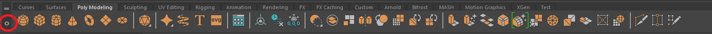
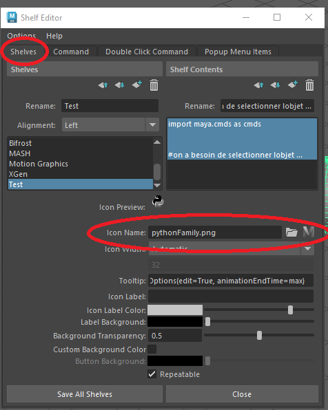

# Installation – Atelier 7
*Ce tutoriel présume que l'user utilise Maya en anglais.*

## 1. Télécharger le script
Téléchargez les fichiers suivants:
- `atelier7.py` https://github.com/rossinipro/NAND403_A26_Ateliers/blob/main/atelier_7/ateliery.py
- `icon.png` https://github.com/rossinipro/NAND403_A26_Ateliers/blob/main/atelier_8/icon.jpg

## 2. Installer le script dans Maya
1. Ouvrez Maya.
2. Dans le menu supérieur, sélectionnez **Windows → Settings/Preferences → Preferences**
3. Dans la section **Files/Projects**, repérez le chemin du dossier `scripts`. (`Documents/maya/[version]/scripts/`)
4. Copiez le fichier `atelier7.py` dans ce dossier

## *Optionnel: Créer une shelf*
1. Dans la côté haut gauche de Maya, cherchez l'engrenage pour accèder aux parametres du shelf. 
2. Choisissez **New Shelf** et donne-lui un nom.

## 3. Ajouter le script dans unee shelf
1. Dans Maya, dans le menu supérieur, sélectionnez **Windows → General Editors → Script Editor**
2. Ouvrez l'onglet Python dans Script Editor
3. Ouvrez le code du Atelier 7 dans Visual Studio Code
4. Copiez le code au complet et collez dans l'onglet Python du Script Editor
5. Sélectionnez le code au complet, appuyez sur le bouton gauche de la souris sur le code, puis faites-la glisser vers la shelf
6. Choisissez Python pour y ajouter le script

## 4. Changer l'icone
1. Après avoir ajouter le script dans la shelf, appuyez sur le bouton droite de la souris sur l'icone du script
2. Ouvrez Edit, puis ouvrez l'onglet Shelves
3. Dans Icon Name, sélectionnez le button de fichier pour chercher l'icone dans votre oudinateur. 
*optionnel: sélectionnez le deuxieme button si vous voulez utilizer un icone fait par Maya* 

## 5. FAQ
- Si le bouton ne fonctionne pas, vérifiez que vous avez sélectionné un objet avant de cliquer dessus.
**Attention :** Les keyframes précédentes de l'objet sélectionné seront supprimées avant la création de la nouvelle animation.